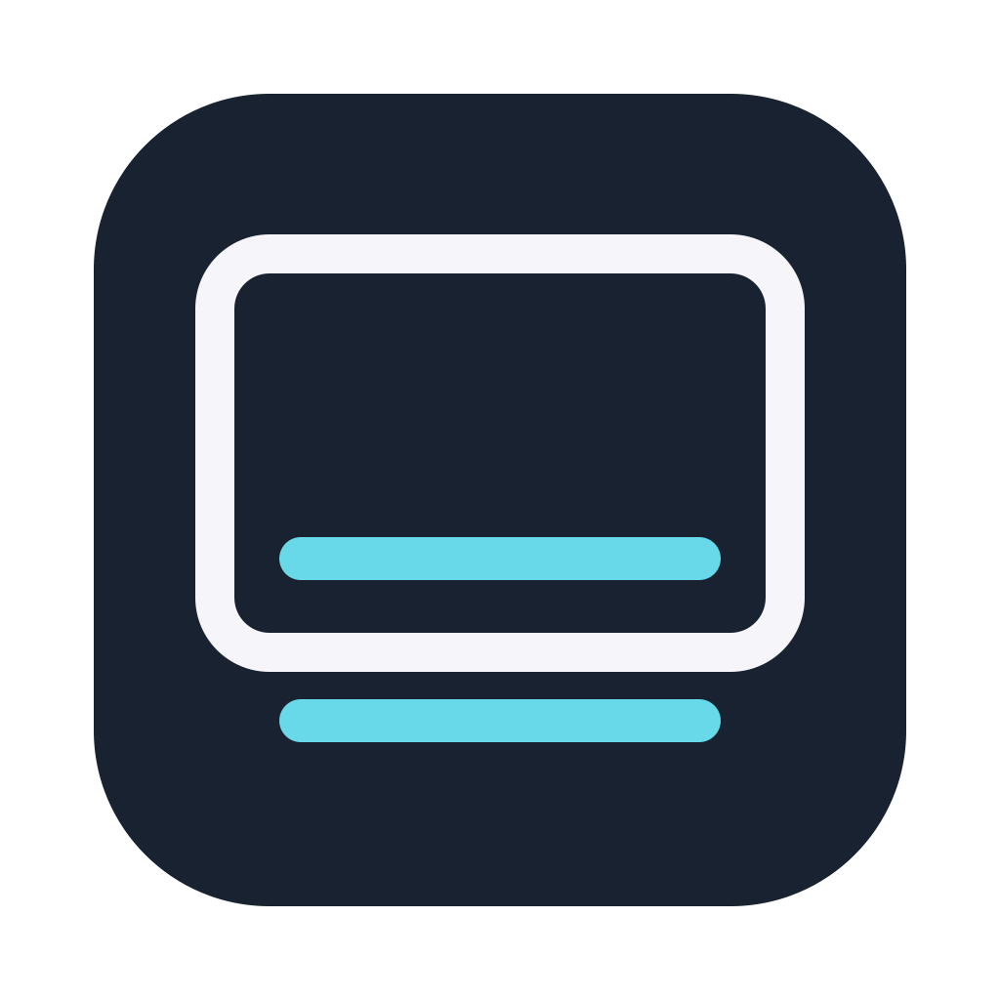

# TouchBar HUD



TouchBar HUD mirrors the current macOS Touch Bar at the bottom of the built-in display. It is intended for a Touch Bar whose touch input still works but whose backlight or visible panel does not.

A small Objective-C menu-bar app for Intel MacBook Pro models with a physical Touch Bar, targeting macOS 13 or later. Version 0.5.2 is a beta tested on a MacBookPro15,1 with macOS 15.7.9; see [verification results and remaining hardware checks](docs/VERIFICATION.md).

## Install and start

1. Build from source below, or download the `TouchBarHUD-0.5.2-beta-adhoc.zip` and matching `.sha256` file from the beta release. This free beta is ad hoc signed and has not been notarized by Apple. Check the download with `shasum -a 256 -c TouchBarHUD-0.5.2-beta-adhoc.zip.sha256` before unzipping it.
2. Move **TouchBar HUD.app** to Applications and open it. macOS may block the downloaded beta because it cannot verify the developer. After trying to open it, go to **System Settings > Privacy & Security**, scroll down, select **Open Anyway**, and confirm **Open**. Only do this for a download you trust. Do not disable Gatekeeper. Quit Touché and other Touch Bar mirror apps first; their simulator streams may compete.
3. Use the menu-bar icon to control the HUD. Physical Touch Bar input does not need Accessibility permission.
4. For mouse control, choose **Enable mouse control…**, then allow the app in **System Settings > Privacy & Security > Accessibility**. Permission is checked when the menu opens, when the HUD appears, and at the start of each mouse gesture. A locally ad-hoc signed rebuild may need to be removed and re-added to that list.
5. Optionally choose **Start at login** in the menu. This uses macOS login-item management and is off until you enable it. If approval is required, the menu opens Login Items settings. Keep the app in a stable location; turn this option off before uninstalling.

Login startup does not show a permission dialog. The app runs without a Dock icon, does not collect telemetry, and does not make network requests. Touch Bar contents may contain sensitive app information; frames are held in memory only and are not recorded.

## Behavior

- Touch Bar display activity reveals the mirror by default. It hides after three seconds without further activity.
- Click or drag on the mirror to operate controls after enabling mouse control.
- With a slider open, place the pointer on it and scroll to adjust it. Scrolling simulates clicks and drags; use it only over a slider. Trackpad momentum is ignored.
- The HUD stays visible while the pointer is over its control surface, or while **Keep visible** is enabled.
- Press **Option-Command-T** or choose **Show/Hide Touch Bar** in the menu. Manual hiding takes priority over automatic reveal and Keep visible until you show it again, enable Keep visible, or re-enable automatic reveal.
- The menu offers hide delays of 1, 2, 3, 5, or 8 seconds and opacity levels of 35%, 50%, 65%, 80%, 90%, or 100%. Settings are saved.
- The HUD stays on the built-in display. It hides and disconnects during sleep, an inactive user session, or when that display is unavailable; it reconnects when those conditions clear.
- **About TouchBar HUD…** shows the logo, version/build, and a brief description.
- **Diagnostics…** shows connection, permission, shortcut, and frame-delivery status. **Retry Touch Bar connection** restarts a failed connection without restarting the app.

## Physical alignment

**Laptop model > Automatic** is the default. The app reads the local Mac model identifier once at startup and selects a 13-, 15-, or 16-inch Intel MacBook Pro sizing profile. The menu shows the detected family; Diagnostics also shows the exact model identifier. There is no system-info polling or network lookup.

Sizing combines the model's native display resolution and pixel density with the live Touch Bar aspect ratio. This keeps the estimated physical size consistent when macOS uses a scaled resolution, and adapts when macOS reports a shorter active Touch Bar. The original 15-inch 2018 MacBook Pro (A1990) calibration remains unchanged.

Use **Laptop model** to save a manual **13-inch MacBook Pro**, **15-inch MacBook Pro**, or **16-inch MacBook Pro** override. This changes display sizing without emulating another device or changing Touch Bar input coordinates. If the model cannot be recognized or read, Automatic clearly reports a 15-inch fallback; choose your family manually.

Sizing is an estimate based on the original calibration, not a factory measurement of every Touch Bar. Use **Physical alignment** to move the HUD in 5-point increments or change its width in 10-point increments for your viewing position. Existing corrections are preserved when changing models. **Reset alignment** clears those corrections while keeping the selected model. See [sizing assumptions and model coverage](docs/MODEL_SIZING.md).

## Compatibility and limitations

Apple does not publish the Touch Bar mirroring or mouse-forwarding APIs. This app loads DFRFoundation dynamically and reports missing functions rather than assuming they exist. OS updates can still change undocumented behavior, including function signatures; symbol checks cannot guarantee compatibility. Test each supported OS before publishing a release. This project is intended for direct distribution, not a Mac App Store submission.

Automatic reveal detects display updates rather than physical touch. App layout changes can reveal the HUD; an animated Touch Bar can keep it visible. A control that does not redraw may not reveal it. Use the shortcut or **Keep visible** when necessary. Global system-input monitoring is not used.

If the shortcut is already owned by another app, use the menu and check Diagnostics. If the mirror is blank or unavailable, quit other mirror apps and retry the connection. Unsupported Macs retain a usable menu for diagnostics and quitting, but cannot mirror a physical Touch Bar.

## Build and verify

Install Apple's Command Line Tools (`xcode-select --install`), then run:

```sh
./build.sh
./scripts/test.sh
"build/TouchBar HUD.app/Contents/MacOS/TouchBarHUD" --check-framework
```

The build is an optimized Intel application in `build/TouchBar HUD.app`, ad-hoc signed for local use. The tests use synthetic frames and require a macOS graphical session and IOSurface access; they do not start a physical Touch Bar stream. The framework check verifies symbols only and does not create a simulator.

See [development notes](CONTRIBUTING.md), [resource measurement](docs/PERFORMANCE.md), and [release instructions](docs/RELEASING.md). The free beta package can be made with `./scripts/package-beta.sh`. A normal trusted download needs Developer ID signing and notarization.

## License

[MIT](LICENSE).
